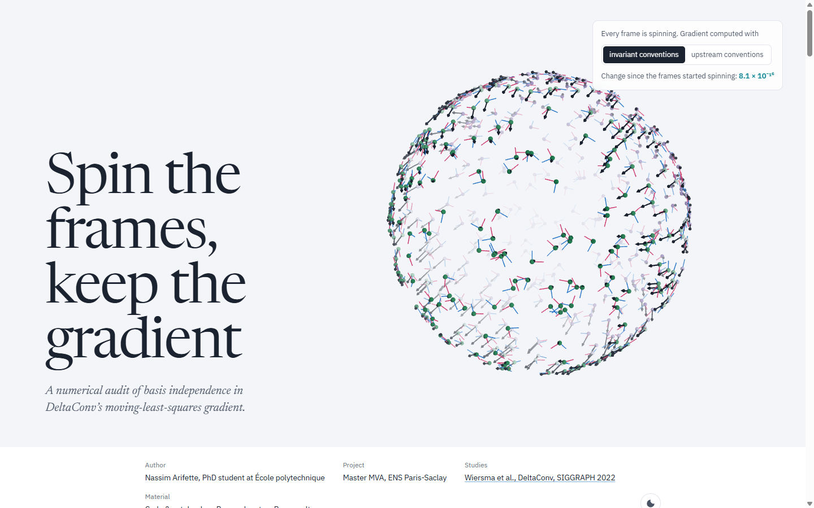
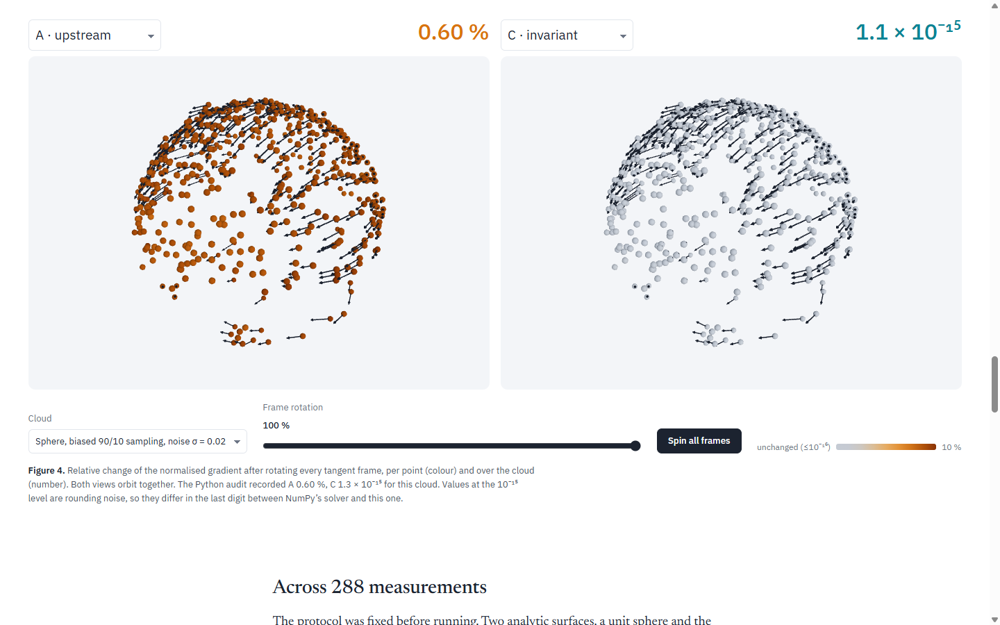

# Spin the frames, keep the gradient

**A numerical audit of basis independence in DeltaConv's moving-least-squares gradient.**

[**Open the interactive article →**](https://nassim-arifette.github.io/deltaconv-point-clouds/)

[](https://nassim-arifette.github.io/deltaconv-point-clouds/)

[DeltaConv](https://doi.org/10.1145/3528223.3530166) (Wiersma et al., SIGGRAPH 2022) learns on point clouds with gradients that live in each point's tangent plane. Its result should not depend on which tangent basis is picked at each point. This project checks whether the discrete implementation keeps that promise.

## The finding in three lines

- Two numerical choices in the official MLS gradient (the ridge penalty and the gradient normaliser) quietly bring the basis back. Rotating every tangent frame moves the normalised gradient by **2.08 % on average and up to 10.2 %**, over 72 synthetic conditions.
- Two small changes (a Frobenius penalty and a rotation-invariant normaliser) bring that drift down to **about 10⁻¹⁵**, which is floating-point noise.
- They do **not** make the gradient more accurate (16.39 % against 16.33 % error), and no trained network was evaluated.

## What you can do on the site

Every figure runs a TypeScript port of the audit's MLS gradient in your browser. It is tested against the NumPy reference on all four saved clouds, gradients included, to within 10⁻¹¹.

| Figure | Try this |
| --- | --- |
| The gradient on a point cloud | Orbit the cloud, compare the MLS estimate with the exact gradient, colour points by error. |
| The penalty | Turn the tangent frame of one real neighbourhood and watch `a² + b² + c²` wobble while `a² + b²/2 + c²` stays flat. |
| The normaliser | See why per-axis L1 sums depend on the axes and the sum of lengths does not. |
| The whole cloud, live | Apply the audit's own random rotations to every frame. The upstream method drifts; the invariant one does not move. |
| 288 measurements | Filter all conditions by surface, sampling, noise and normals, and follow one condition across the four methods. |



## Reproduce the audit

Only NumPy is needed. A full run takes about nine seconds on a laptop CPU.

```bash
python -m pip install -r requirements.txt
python -m pytest tests -q
python -m deltaconv_audit.experiment --output results/runs/my-audit --points 512 --seeds 0 1 2
```

Or open [`notebooks/01_operator_audit.ipynb`](notebooks/01_operator_audit.ipynb) locally or on Colab.

| File | What it contains |
| --- | --- |
| [`docs/research.md`](docs/research.md) | Protocol, derivation, metrics and limits (French) |
| [`results/cpu_reference/results.json`](results/cpu_reference/results.json) | All 288 rows, configuration, environment and source hashes |
| [`results/cpu_reference/metrics.csv`](results/cpu_reference/metrics.csv) | The same measurements as a table |
| [`notebooks/02_official_replication.ipynb`](notebooks/02_official_replication.ipynb) | Isolated install of the official code, parity check, ModelNet40 baseline (not yet run) |

## What this does not show

- **No trained network was run.** The audit transcribes the gradient formulas of the official code to NumPy; classification accuracy, learned robustness and GPU speed were not measured.
- **The PyTorch parity check is pending.** [`scripts/check_upstream.py`](scripts/check_upstream.py) needs PyTorch and PyG.
- **The 72 conditions are controlled variations of two analytic surfaces**, not 72 independent objects.
- **Tangent-basis independence is not rotation invariance** of a classifier fed raw `xyz` positions.

## Repository layout

| Path | Role |
| --- | --- |
| `deltaconv_audit/` | NumPy MLS gradient, analytic surfaces and the experiment |
| `tests/` | Polynomial reproduction, change of basis, rigid rotations, export checks |
| `results/cpu_reference/` | The measured reference run |
| `web/` | Source of the website (Vite + TypeScript, Three.js, D3, KaTeX). See [`docs/SITE.md`](docs/SITE.md) |
| `tools/` | Data export for the site, notebook generation, link checks |

To work on the site: `cd web && npm ci && npm run dev`. GitHub Actions tests, builds and publishes it on every push to `main`.

## Credits

DeltaConv, its architecture and its operators are the work of Ruben Wiersma, Ahmad Nasikun, Elmar Eisemann and Klaus Hildebrandt. The baseline transcribes [`grad_div_mls.py`](https://github.com/rubenwiersma/deltaconv/blob/186fec369fa2ceb4559830bc421282dddb2300a2/deltaconv/geometry/grad_div_mls.py) at commit `186fec3` (MIT, see [`THIRD_PARTY_NOTICES.md`](THIRD_PARTY_NOTICES.md)). This repository contributes the audit, two explicit numerical changes and their ablations.

Nassim Arifette, PhD student at École polytechnique. Master MVA project, ENS Paris-Saclay.
